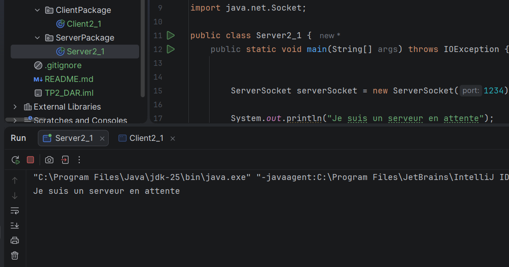
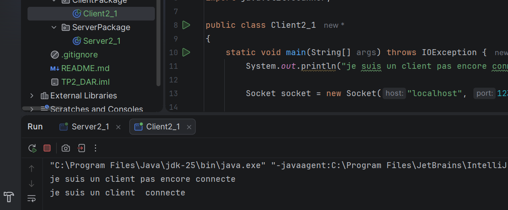
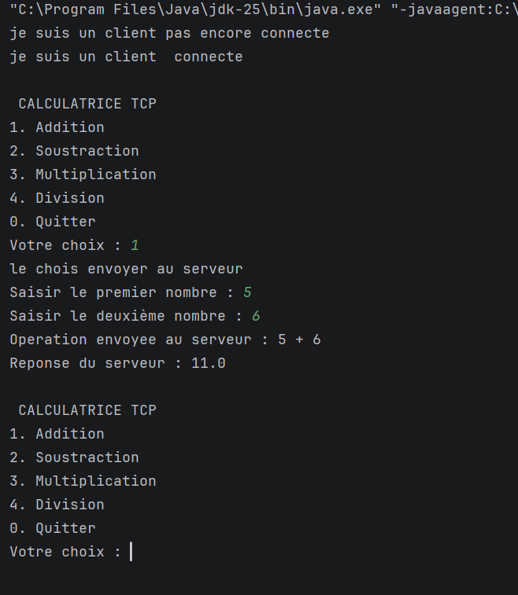
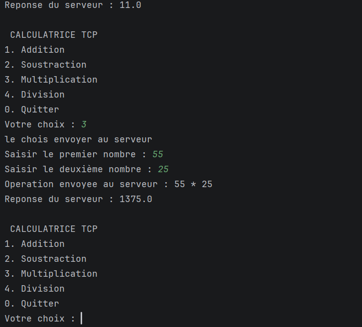
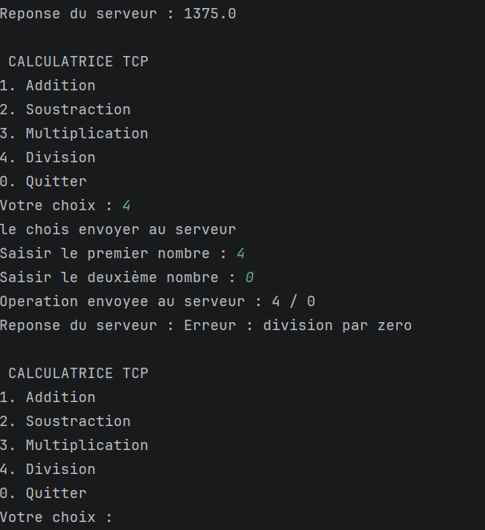
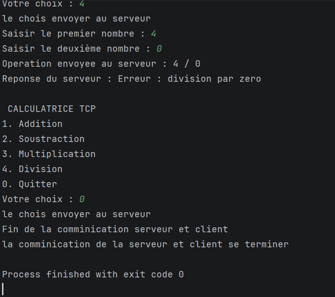
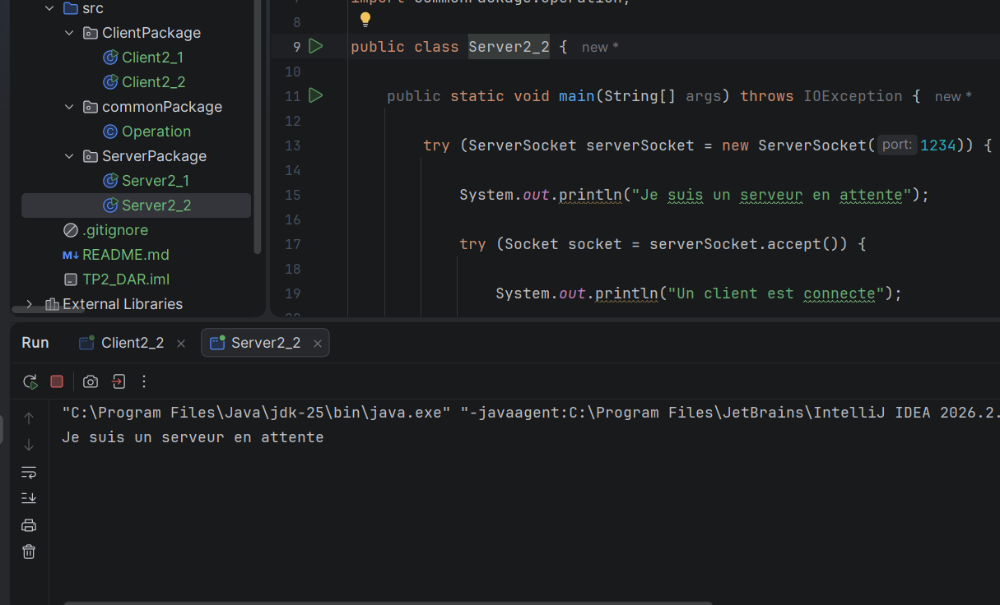
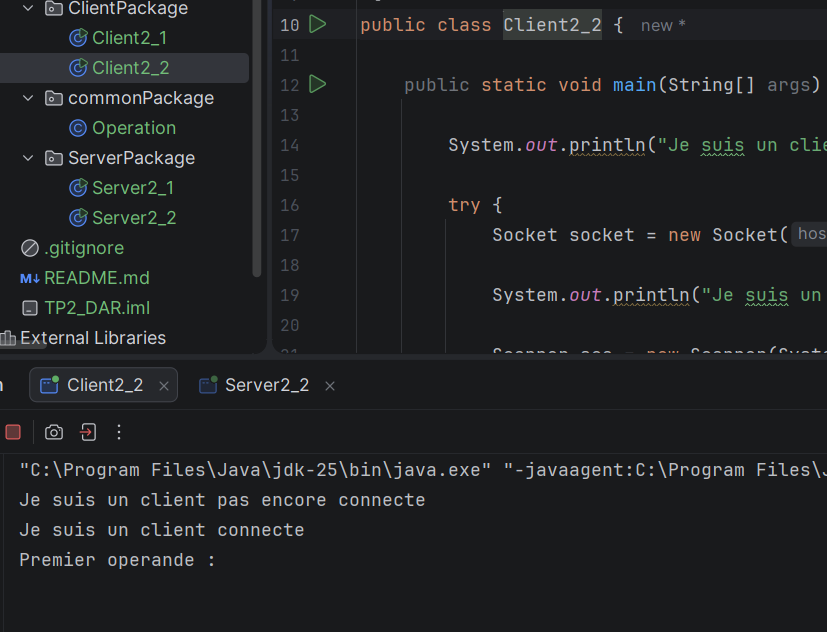
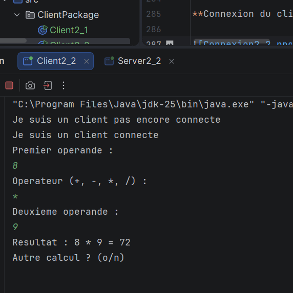
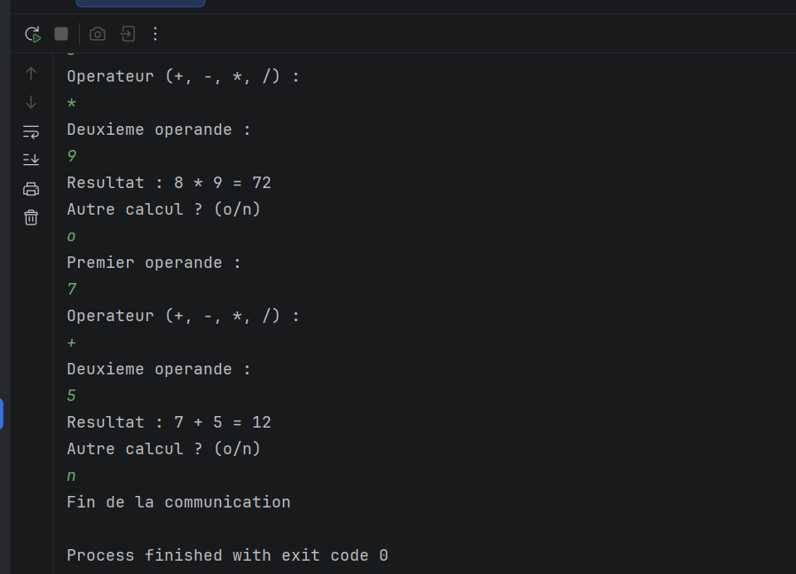

# TP2 --- Les sockets en mode connecté TCP : échange de chaînes de caractères

**Module :** Développement d'applications réparties\
**Activité 2-1 :** Échange de chaînes de caractères entre un client et
un serveur via les sockets TCP\
**Langage :** Java (JDK 8 ou supérieur)\
**Port TCP :** `1234`

------------------------------------------------------------------------

## 1. Objectifs

L'objectif de ce TP est d'améliorer l'application client/serveur
réalisée au TP1 afin de permettre l'échange de chaînes de caractères et
l'exécution d'une opération complète.

L'application permet au client de choisir une opération, de saisir deux
nombres, puis d'envoyer les informations au serveur. Le serveur effectue
le calcul et renvoie le résultat au client.

Les opérations prises en charge sont :

-   Addition : `+`
-   Soustraction : `-`
-   Multiplication : `*`
-   Division : `/`
-   Arrêt de la communication : choix `0`

## 2. Environnement utilisé

-   Java JDK 8 ou supérieur
-   Eclipse, IntelliJ IDEA ou Visual Studio Code
-   Sockets TCP (`ServerSocket` et `Socket`)
-   Flux `DataInputStream` et `DataOutputStream`
-   Git et GitHub pour le dépôt du projet

## 3. Organisation du projet

Le projet contient deux classes principales :

``` text
TP2/
├── src/
│   ├── ServerPackage/
│   │   └── Server2_1.java
│   └── ClientPackage/
│       └── Client2_1.java
├── captures/
│   ├── serveur_attente.png
│   ├── client_connecte.png
│   ├── addition.png
│   ├── multiplication.png
│   ├── division_zero.png
│   └── quitter.png
└── README.md
```

> **Captures d'écran :** les images ci-dessous sont des emplacements à
> compléter. Après avoir exécuté le programme, prenez vos propres
> captures d'écran, placez-les dans le dossier `captures/` avec les noms
> indiqués, puis ajoutez-les au dépôt GitHub.

## 4. Fonctionnement de l'application

### 4.1 Côté serveur

1.  Le serveur ouvre le port TCP `1234`.
2.  Il attend la connexion d'un client avec `accept()`.
3.  Il reçoit les messages sous forme de chaînes grâce à `readUTF()`.
4.  Il convertit les deux opérandes en nombres avec
    `Double.parseDouble()`.
5.  Il effectue l'opération demandée.
6.  Il envoie le résultat sous forme de chaîne avec `writeUTF()`.
7.  Il ferme la connexion lorsque le client envoie le choix `0`.

### 4.2 Côté client

1.  Le client se connecte au serveur sur `localhost`, port `1234`.
2.  Il affiche un menu d'opérations.
3.  Il envoie le choix, puis le premier nombre, l'opérateur et le
    deuxième nombre.
4.  Il reçoit la réponse du serveur et l'affiche.
5.  Le choix `0` termine la communication.

### 4.3 Ordre des messages échangés

Le client et le serveur doivent impérativement respecter le même ordre
de lecture et d'écriture :

    Ordre Client : envoi          Serveur : réception
  ------- ----------------------- ----------------------------------------
        1 Choix (`ch`)            `ch = dis.readUTF()`
        2 Premier nombre (`a`)    `aString = dis.readUTF()`
        3 Opérateur (`op`)        `op = dis.readUTF()`
        4 Deuxième nombre (`b`)   `bString = dis.readUTF()`
        5 Réponse du serveur      `resultat = dis.readUTF()` côté client

Le choix `0` est envoyé seul pour indiquer la fin de la communication.

## 5. Captures d'écran des résultats

### 5.1 Serveur en attente d'un client

Le serveur est lancé en premier et attend une connexion sur le port
`1234`.



### 5.2 Connexion du client

Le client se connecte au serveur. Les deux applications peuvent alors
échanger des messages.



### 5.3 Exemple : addition de 5 et 6

Le client choisit l'addition et saisit `5` et `6`. Le serveur calcule
`5 + 6` et renvoie `11.0`.



### 5.4 Exemple : multiplication de 55 par 25

Le serveur reçoit les deux nombres et l'opérateur `*`, puis renvoie le
résultat `1375.0`.



### 5.5 Exemple : division par zéro

Le serveur détecte que le diviseur est égal à zéro et renvoie un message
d'erreur au client.



### 5.6 Fin de la communication

Le client choisit `0`. Le serveur détecte ce choix et ferme la
connexion.



## 6. Comparaison entre le TP1 et le TP2

  -------------------------------------------------------------------------------
Élément                 TP1 --- Activité        TP2 --- Activité 2-1
précédente
  ----------------------- ----------------------- -------------------------------
Données échangées       Données numériques      Chaînes de caractères
typées, par exemple     transmises avec `writeUTF()` et
`int` et `double`       `readUTF()`

Envoi de l'opération    Le client envoie un     Le client envoie le choix puis
code numérique pour     les nombres et l'opérateur sous
représenter l'opérateur forme de chaînes

Lecture côté serveur    `readInt()` et          `readUTF()`
`readDouble()`

Conversion des nombres  Les valeurs sont déjà   Les chaînes sont converties
reçues comme nombres    avec `Double.parseDouble()`

Opérateur               Représenté par un code, Représenté par `+`, `-`, `*` ou
par exemple `1`, `2`,   `/`
`3` ou `4`

Résultat renvoyé        `writeDouble()`         `writeUTF(String.valueOf(r))`

Validation              Validation du choix et  Validation des nombres et de
contrôle de la division l'opérateur, avec gestion des
par zéro                erreurs

But principal           Réaliser une            Comprendre l'échange de chaînes
calculatrice            de caractères et transmettre
client/serveur avec des les éléments d'une opération
données numériques
  -------------------------------------------------------------------------------

**Bilan :** le TP2 fait évoluer le protocole d'échange. Les nombres et
l'opérateur sont transmis sous forme de chaînes de caractères, puis les
nombres sont convertis côté serveur pour réaliser le calcul. Les deux
programmes doivent suivre exactement le même ordre d'envoi et de
réception.

## 7. Exécution du programme

1.  Vérifier que les classes sont placées dans les packages
    `ServerPackage` et `ClientPackage`.
2.  Lancer `Server2_1.java`.
3.  Lancer ensuite `Client2_1.java`.
4.  Tester les quatre opérations.
5.  Tester la division par zéro.
6.  Choisir `0` pour terminer la communication.
7.  Ajouter les captures d'écran dans `captures/`.
8.  Déposer le projet et le fichier `README.md` dans le dépôt GitHub,
    puis transmettre le lien du dépôt sur l'ENT.

> **Remarque sur l'adresse :** `localhost` fonctionne lorsque le client
> et le serveur s'exécutent sur le même ordinateur. Pour utiliser deux
> ordinateurs, remplacer `localhost` côté client par l'adresse IP du
> serveur et faire écouter le serveur sur une interface réseau
> accessible.

## 8. Conclusion

Ce TP permet de comprendre la communication TCP en Java et l'utilisation
des flux d'entrée/sortie pour transmettre des chaînes de caractères
entre un client et un serveur. Il montre également l'importance de
respecter un protocole commun, de convertir les données reçues et de
traiter les erreurs possibles.

## Activité 2-2 : Échange d’objets Java avec les sockets TCP

### 1. Objectif

L’objectif de cette activité est de réaliser une communication entre un client et un serveur en utilisant les sockets TCP et les flux d’objets Java (`ObjectInputStream` et `ObjectOutputStream`).

Contrairement à l’activité 2-1, où les données sont échangées sous forme de chaînes de caractères, cette activité permet d’envoyer directement un objet Java représentant une opération mathématique.

### 2. Structure du projet

Le projet est organisé en trois classes principales :

- `ClientPackage.Client2_2` : permet à l’utilisateur de saisir les opérations et de les envoyer au serveur.
- `ServerPackage.Server2_2` : reçoit les objets, effectue les calculs et renvoie les résultats au client.
- `commonPackage.Operation` : représente une opération mathématique avec deux opérandes et un opérateur.

### 3. Principe de fonctionnement

1. Le serveur démarre et écoute les connexions sur le port `1234`.
2. Le client se connecte au serveur via une socket TCP.
3. Le client crée un objet `Operation` contenant les deux nombres et l’opérateur.
4. L’objet est envoyé au serveur avec `ObjectOutputStream`.
5. Le serveur reçoit l’objet avec `ObjectInputStream`, effectue le calcul et renvoie le résultat.
6. Le client affiche le résultat reçu.
7. La communication continue jusqu’à ce que l’utilisateur choisisse de terminer en envoyant le message `FIN`.

### 4. Exemple d’exécution

**Exemple 1 : Addition**

Entrée du client :

```text
Premier nombre : 5
Opérateur (+, -, *, /) : +
Deuxième nombre : 6
```

Résultat affiché :

```text
5 + 6 = 11
```

**Exemple 2 : Multiplication**

```text
Premier nombre : 7
Opérateur (+, -, *, /) : *
Deuxième nombre : 8

Résultat : 56
```

**Exemple 3 : Division par zéro**

```text
Premier nombre : 10
Opérateur (+, -, *, /) : /
Deuxième nombre : 0

Erreur : division par zéro
```

### 5. Captures d’écran

Les captures suivantes illustrent le fonctionnement de l’application. Remplacer les noms ci-dessous par les noms de vos captures réelles si nécessaire.

**Démarrage du serveur**



**Connexion du client et envoi d’une opération**



**Résultat d’une opération mathématique**



**Fin de la communication**



### 6. Comparaison entre les activités 2-1 et 2-2

| Critère | Activité 2-1 | Activité 2-2 |
|---|---|---|
| Type de données | Chaînes de caractères | Objets Java |
| Flux utilisés | `DataInputStream` et `DataOutputStream` | `ObjectInputStream` et `ObjectOutputStream` |
| Transmission des opérations | Envoi séparé des nombres et de l’opérateur | Envoi d’un objet `Operation` |
| Traitement des données | Conversion des chaînes en nombres | Récupération des attributs de l’objet |
| Complexité | Plus simple pour des messages textuels | Plus adaptée à l’échange de structures d’objets |

### 7. Conclusion

Cette activité nous a permis de comprendre comment échanger des objets Java entre un client et un serveur à travers une connexion TCP. L’utilisation de la sérialisation permet de transmettre une instance de la classe `Operation` sans devoir envoyer séparément chacun de ses attributs.

Nous avons également mis en pratique les flux d’objets, le traitement des opérations mathématiques, la gestion de la division par zéro et l’arrêt propre de la communication.

Ainsi, l’activité 2-2 constitue une évolution de l’activité 2-1 en proposant une communication fondée sur des objets Java plutôt que sur des chaînes de caractères.

